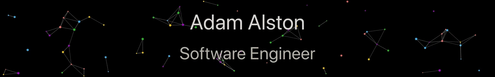

<div align="center">



# Adam Alston

### Software Engineer

<p>
  Building scalable systems, crafting thoughtful developer experiences, and turning ideas into production-ready software.
</p>

<p>
  <a href="https://github.com/yourusername">
    
  </a>
  <a href="https://linkedin.com/in/yourusername">
    
  </a>
  <a href="mailto:you@example.com">
    
  </a>
</p>

</div>

---

## About Me

```ts
const adam = {
  role: "Software Engineer",
  languages: ["TypeScript", "Python", "Go", "JavaScript"],
  frontend: ["React", "Next.js", "TailwindCSS"],
  backend: ["Node.js", "Express", "PostgreSQL"],
  cloud: ["AWS", "Docker", "Kubernetes"],
  interests: [
    "Distributed Systems",
    "Developer Tooling",
    "AI Applications",
    "System Design"
  ],
};
